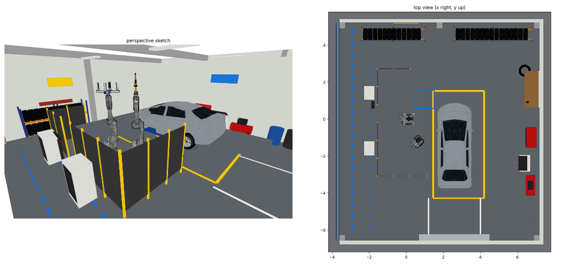

# isaac_ws — 타이어 교체 디지털트윈

NVIDIA Isaac Sim 5.1 에서 Kawasaki RS080N 로봇 2대가 리프트 위 차량의 앞바퀴를 **비전으로 측정 → 너트 풀기 → 휠 탈거 → 재장착 → 너트 조임**까지 자동으로 수행하는 타이어 교체 셀 디지털트윈 프로젝트입니다.



## 실행 환경

- OS: Ubuntu 24.04
- 시뮬레이터: Isaac Sim 5.1 (`~/isaacsim` 기본 경로, 다른 경로면 `ISAACSIM_PATH` 지정)
- GPU: NVIDIA RTX
- ROS 2: Jazzy (카메라 토픽 확인용. Isaac Sim 내장 브리지를 쓰므로 시연 실행 자체에는 필요 없음)
- 로봇: Kawasaki RS080N × 2 (4조 휠 그리퍼 / Atlas Copco QST62-230CT 너트러너), 손목 카메라 Intel RealSense D455 × 2

## 시작하기

처음이라면 [`docs/getting_started.md`](docs/getting_started.md) 를 따라 clone 부터 시연 실행까지 진행하세요. 셀 구성과 동작 순서는 [`docs/architecture.md`](docs/architecture.md), 지금까지의 작업 기록과 현재 상태는 [`docs/history/`](docs/history/README.md) 에 있습니다.

빠른 실행:

```bash
cd tire_twin_all/tire_cell_v7_integrated
bash run.sh --no-ros
```

## 저장소 구조

```text
isaac_ws/
├── docs/                              # 시작 가이드, 아키텍처, 브랜치 규칙, 작업 기록, 발표 PDF, 확인용 그림
│   ├── camera_check/                  # 손목 카메라 확인 캡처
│   └── history/                       # 날짜별 작업 기록
└── tire_twin_all/
    ├── tire_cell_v7_integrated/       # 최신 통합본 (비전 + 분해·너트 보관·재조립 + 카메라·ROS 2·트랙)
    ├── tire_cell_v3/                  # 통합 전 본 (분해 + 카메라·ROS 2·트랙)
    └── tire_demo_v2/                  # 초기 시연 (로봇 1대가 휠만 빼서 내려놓음)
```

버전별 파일 목록은 [`tire_twin_all/README.md`](tire_twin_all/README.md), 최신본의 상세 설명(물리값, 트랙, 카메라, ROS 2 토픽, 비전 측정 결과)은 [`tire_twin_all/tire_cell_v7_integrated/README.md`](tire_twin_all/tire_cell_v7_integrated/README.md) 참고.

## 현재 상태

| 항목 | 상태 |
|---|---|
| `tire_cell_v7_integrated` | 전체 사이클 Isaac Sim 실행 확인 (`bash run.sh`, ROS 토픽 포함). `--no-ros` 측정값: 최종 휠 자세 오차 0.6 mm / 0.01°, 사이클 322 s(시뮬레이션 시간), 보호 정지 없음 |
| 비전 너트 검출 | 검출 결과 영상(`vision_debug.png`) 확인 |
| `tire_demo_v2` | 실행 확인 |
| 차량 4종, 트레이, 맵, `view.sh` | Isaac Sim 실행 검증 전 |

## 브랜치 전략

`main` 은 항상 실행 가능한 상태로 유지하고, 작업은 별도 브랜치에서 한 뒤 `main` 으로 PR 을 보냅니다. 자세한 규칙은 [`docs/branching.md`](docs/branching.md) 참고.

## 문서

| 문서 | 내용 |
|---|---|
| [`docs/getting_started.md`](docs/getting_started.md) | 설치 확인, 실행, 씬 보기, ROS 2 토픽 확인 |
| [`docs/architecture.md`](docs/architecture.md) | 셀 구성, 작업 순서, 비전, 물리 모델 범위 |
| [`docs/branching.md`](docs/branching.md) | 브랜치·커밋·PR 규칙 |
| [`docs/history/`](docs/history/README.md) | 작업 기록, 현재 상태, 남은 작업 |
| [`docs/타이어교체_디지털트윈_정리.pdf`](docs/타이어교체_디지털트윈_정리.pdf) | 발표용 정리 자료 |
